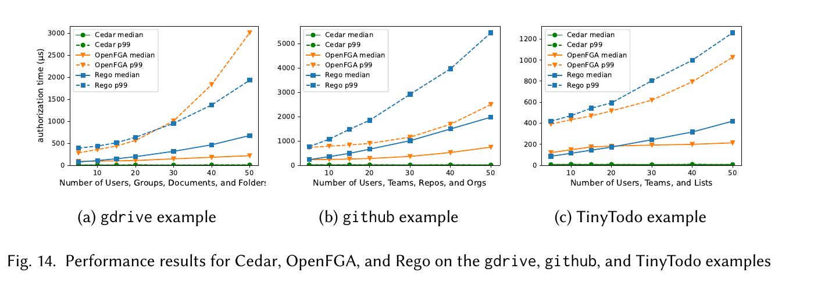
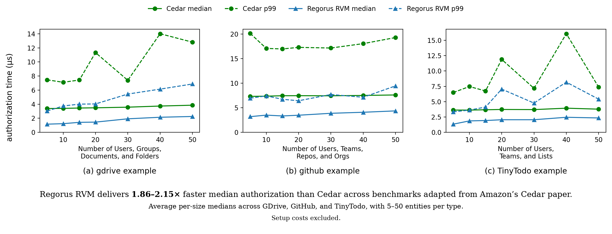

# Cedar vs. Regorus RVM

## Original Cedar paper

The paper reports **42.8-80.8x faster median authorization for Cedar than
OPA/Rego** across the GDrive, GitHub, and TinyTodo benchmarks.



Figure 14 from [Cutler et al., *Cedar: A New Language for Expressive, Fast, Safe,
and Analyzable Authorization* (2024)](https://arxiv.org/pdf/2403.04651),
[CC BY 4.0](https://creativecommons.org/licenses/by/4.0/).
Cropped from PDF page 21; figure content unchanged.

## Regorus RVM vs. Cedar

Regorus RVM delivers **1.86-2.15x faster median authorization than Cedar**
across our updated versions of these benchmarks.



Ratios compare average per-size medians over **5-50 entities per type**, with
100,000 requests per point. **Setup costs are excluded.** Hardware, engine
versions, and policy implementations differ from the paper; these results are
not a direct RVM-versus-OPA comparison.

## Reproduce

Requires Rust/Cargo, a C/C++ toolchain, OpenSSL development headers, and Python 3
with `matplotlib` and `pandas`.

```shell
git clone --branch benchmark-regorus-rvm-upstream https://github.com/anakrish/cedar-examples.git
cd cedar-examples/oopsla2024-benchmarks

git clone https://github.com/cedar-policy/cedar-spec cedar-spec
git -C cedar-spec checkout ac201c127d31cff4bea784c87d3e3d3e8fb8bfe9
git clone https://github.com/cedar-policy/cedar cedar-spec/cedar
git -C cedar-spec/cedar checkout 062c8fe71016723883b3ae31298720363a1e14c8

APPS=gdrive,github,tiny-todo BACKENDS=regorus-rvm \
  NUM_HIERARCHIES=200 NUM_REQUESTS=500 \
  NUM_ENTITIES=5,10,15,20,30,40,50 \
  OUTPUT_ROOT=output/reproduced \
  bash reproduce.sh
```

The run checks every Cedar/RVM decision pair and saves CSVs, plots, and source
provenance under `output/reproduced/cedar-vs-regorus-rvm/`.
Use an unused `OUTPUT_ROOT`; existing results are never overwritten.
Random workloads and machine conditions mean timings will vary.

For larger workloads, change `NUM_ENTITIES` to `100,200,300,400,500` and choose a
new output directory. See [methodology and detailed reproduction notes](oopsla2024-benchmarks/README.md)
for pinned engine versions, preprocessing, warm-up, measurement controls, and
the presentation-only caption on the published PNG.
